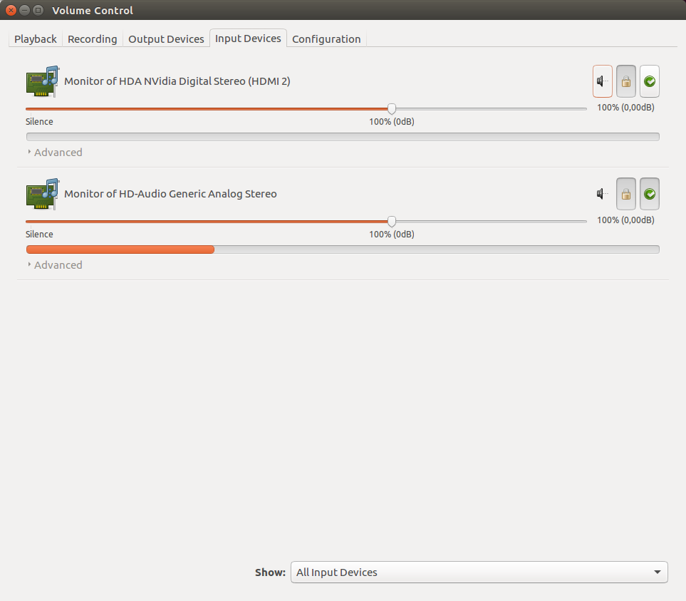
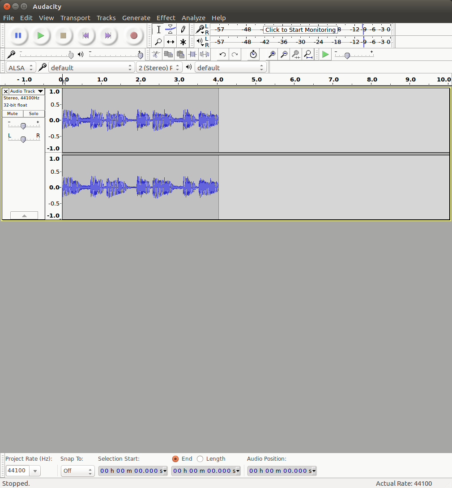

# AI Live - back end of the "Sheen"

## Usage

To start the visual generation:

1. Open "terminal"
1. Type `cd ~/Deeplearning/ailive` - this navigates to the project
1. Type `python3.6 app.py`
1. If this doesn't work type: `ps aux | grep python |cut -c1-5 | xargs kill -9`
1. Then retype `python3.6 app.py`
1. Navigate in the browser to `localhost:5000` to view the visuals
1. press `F11` for full screen
1. To get the control pad navigate to `localhost:5000/controls` into the browser
1. To quit select the terminal again and press `ctrl+c` or close the window

## Recording/ streaming from sound device

### Setup

1. Plug in the earphones and check sound output
1. Install pulse audio control `sudo apt-get install pulseaudio`
1. Open the pulse audio control panel (see below)
1. Make sure that "Analog Stereo Output" is selected for headphones
1. Put some music on youtube or such like on.

### Recording wav from audacity

1. Open audacity and select the earphones as microphone input (see below)
1. You may need to try a few devices to get it to work
1. To get the wav click "Export" in the menu   

### Streaming audio/ device directly into python

1. List devices with `python3.6 input.py -l`   
1. Check output in python by doing: `python3.6 input.py -d <number-of-default>` (with me it was 6)
1. Output should look vaguely sinusoidal. If it's white noise like or silent, something is not working.